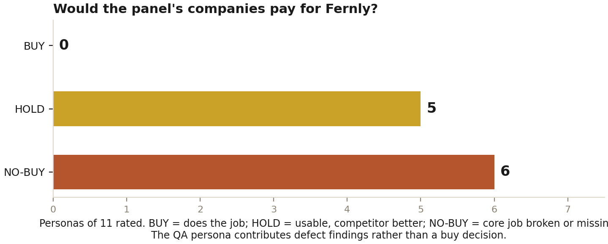
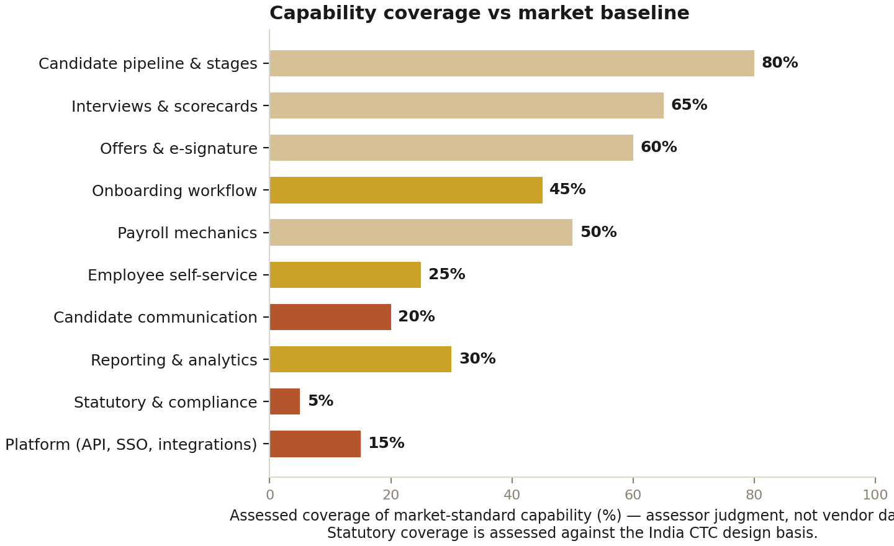

# Fernly Persona Acceptance Assessment

> **Fernly Recruitment & HR Suite — honest verdicts from 10 personas at a
> 10-employee and a 50-employee company.**
>
> Buy-vs-competitor evaluation · Panel: BrightLeaf Studio (10) and Meridian
> Systems (50) · Assessment date: 5 November 2026 · Prepared for the product
> owner — internal.
>
> Markdown edition of the formatted report
> (`Fernly_Persona_Acceptance_Assessment.docx`, same folder); charts in
> [`assets/`](assets/). Fixes shipped during the audit are in commit `1d7f246`.

## Contents

- [1. Executive Summary](#1-executive-summary)
- [2. Test Scope, Panel and Method](#2-test-scope-panel-and-method)
  - [2.1 The panel: two companies, twelve personas](#21-the-panel-two-companies-twelve-personas)
  - [2.2 Method and evidence standard](#22-method-and-evidence-standard)
  - [2.3 What this assessment did not cover](#23-what-this-assessment-did-not-cover)
- [3. Persona-by-Persona Findings](#3-persona-by-persona-findings)
  - [3.1 A1 — Asha Verma, Founder/CEO (ADMIN, 10-employee company)](#31-a1--asha-verma-founderceo-admin-10-employee-company)
  - [3.2 A2 — Tom Baker, Office Manager / part-time HR (HR role, 10-employee company)](#32-a2--tom-baker-office-manager--part-time-hr-hr-role-10-employee-company)
  - [3.3 A3 — Jia Chen, New Joiner (MEMBER, 10-employee company)](#33-a3--jia-chen-new-joiner-member-10-employee-company)
  - [3.4 A4 — Leo Martins, Existing Employee (MEMBER, 10-employee company)](#34-a4--leo-martins-existing-employee-member-10-employee-company)
  - [3.5 B1 — Meera Iyer, HR Manager (HR role, 50-employee company)](#35-b1--meera-iyer-hr-manager-hr-role-50-employee-company)
  - [3.6 B2 — Ingrid Solberg, Engineering Director / Hiring Manager (MANAGER, 50-employee company)](#36-b2--ingrid-solberg-engineering-director--hiring-manager-manager-50-employee-company)
  - [3.7 B3 — Arjun Mehta, Accountant (ADMIN / payroll:manage, 50-employee company)](#37-b3--arjun-mehta-accountant-admin--payrollmanage-50-employee-company)
  - [3.8 B4 — Rohan Das, New Joiner (MEMBER, 50-employee company)](#38-b4--rohan-das-new-joiner-member-50-employee-company)
  - [3.9 B5 — Diego Morales, Senior Developer / assigned interviewer (MEMBER, 50-employee company)](#39-b5--diego-morales-senior-developer--assigned-interviewer-member-50-employee-company)
  - [3.10 B6 — Soren Lindqvist, QA Engineer (MEMBER; defect-hunting persona)](#310-b6--soren-lindqvist-qa-engineer-member-defect-hunting-persona)
  - [3.11 B7 — Vikram Rao, IT Admin (ADMIN, 50-employee company)](#311-b7--vikram-rao-it-admin-admin-50-employee-company)
  - [3.12 B8 — Aisha Khan, External Candidate (public tokenized link)](#312-b8--aisha-khan-external-candidate-public-tokenized-link)
- [4. Cross-Persona Defect Analysis](#4-cross-persona-defect-analysis)
- [5. Competitive Gap Analysis](#5-competitive-gap-analysis)
- [6. Improvement Backlog (P0 / P1 / P2)](#6-improvement-backlog-p0--p1--p2)
- [7. Conclusions and Recommended Path](#7-conclusions-and-recommended-path)
- [8. Appendix A — Fixes Applied During This Assessment](#8-appendix-a--fixes-applied-during-this-assessment)
- [9. Appendix B — Evidence and Sources](#9-appendix-b--evidence-and-sources)

---

# 1. Executive Summary
This assessment answers one question: would a small or mid-sized company that paid for Fernly get the functionality it paid for? Ten personas were recruited across two simulated companies — BrightLeaf Studio, a 10-employee design agency, and Meridian Systems, a 50-employee B2B SaaS firm. Every persona logged into the running application and worked their real job: the CEO looked for her HR cockpit, the HR manager ran a candidate from entry to a signed offer to an auto-created employee account, the accountant ran payroll, hiring managers filled scorecards, new joiners looked for their onboarding, an external candidate signed an offer through the public tokenized link, and a QA engineer hunted for edge cases. Every finding below was reproduced live in the browser or traced to exact lines of code — nothing in this report is speculative.

The verdict is blunt. **Not one persona issued an unqualified BUY.** Six of eleven rated personas answered NO-BUY and five answered HOLD. The recruitment spine — configurable pipeline, stage snapshots, interview scheduling with interviewer conflict detection, structured scorecards, audited outbox, tokenized e-signature, deterministic employee creation, locked payroll runs — is genuinely well engineered: server-side RBAC held against every probing attempt, the audit log captured before/after values on every mutation, and the candidate-to-employee journey completed end-to-end without a single crash. But the product around that spine is not yet a payable HR platform: employees cannot see their own payslips at all, there is no statutory payroll engine despite an India-CTC design basis, candidate emails silently skip when no mail provider is configured while the UI claims they were sent, and plain members assigned as interviewers are locked out of the Hiring module entirely.

Two critical defects were fixed during this assessment and are already merged (commit 1d7f246): loss-of-pay days could exceed a month's length and save a **negative net pay of -$223.33** (verified live), and the offer/joining flows claimed emails were delivered when they were skipped. The remaining improvement backlog contains 39 open items: 5 at P0, 17 at P1 and 17 at P2, each with the personas it hurts, an effort class and a concrete fix direction. The recommended path: close the five P0 items in the next two milestones, then this becomes a credible lightweight ATS with attached payroll for 10-50 employee companies — today it should be sold as a recruitment tracker, not an HR suite.

*Figure 1: Persona verdicts across the rated panel (the QA persona contributes defect findings rather than a buy decision).*

# 2. Test Scope, Panel and Method
## 2.1 The panel: two companies, twelve personas
The panel deliberately spans company size because the product must serve both: a 10-person company where the founder is also the HR department, and a 50-person company with dedicated HR, finance and IT functions. Roles map to the application's four RBAC roles (ADMIN, HR, MANAGER, MEMBER); the external candidate uses only the public offer-signing link and never authenticates.

**Table 1: Persona panel**

| **#** | **Persona**                                    | **Company**     | **App role** | **Core jobs to be done**                                             |
|--------|------------------------------------------------|-----------------|--------------|----------------------------------------------------------------------|
| A1     | Asha Verma — Founder/CEO                       | BrightLeaf (10) | ADMIN        | Runs all HR herself; hiring, payroll, config in under 2 hours a week |
| A2     | Tom Baker — Office Manager (part-time HR)      | BrightLeaf (10) | HR           | Non-specialist: pipeline, onboarding, leave queue, payroll           |
| A3     | Jia Chen — New Joiner (Junior Designer)        | BrightLeaf (10) | MEMBER       | Day-1 to month-1 onboarding; first payslip                           |
| A4     | Leo Martins — Senior Designer (3 years)        | BrightLeaf (10) | MEMBER       | Self-service: leave, calendar, payslip                               |
| B1     | Meera Iyer — HR Manager                        | Meridian (50)   | HR           | Full funnel: candidate to signed offer to joined employee            |
| B2     | Ingrid Solberg — Engineering Director          | Meridian (50)   | MANAGER      | Assigned interviews, scorecards, hire input                          |
| B3     | Arjun Mehta — Accountant                       | Meridian (50)   | ADMIN        | Salary structures, monthly runs, payslip edits, lock, YTD            |
| B4     | Rohan Das — New Joiner (Backend Engineer)      | Meridian (50)   | MEMBER       | Onboarding checklist, documents, first payslip                       |
| B5     | Diego Morales — Senior Developer (interviewer) | Meridian (50)   | MEMBER       | See assigned interviews, submit scorecard                            |
| B6     | Soren Lindqvist — QA Engineer                  | Meridian (50)   | MEMBER       | Break it: boundaries, invalid input, permission probes               |
| B7     | Vikram Rao — IT Admin                          | Meridian (50)   | ADMIN        | Users, roles, audit trail, security posture, offboarding             |
| B8     | Aisha Khan — External Candidate                | —               | public link  | Receive offer, review package, e-sign                                |

*Personas A1-A4 tested with the same accounts across both simulated companies where the role permitted; each persona's journeys were walked end-to-end in live browser sessions.*

## 2.2 Method and evidence standard
Testing combined three lenses. First, live browser walkthroughs: each role signed into the running application and performed its real journeys (login, candidate creation, scheduling, scorecards, offers, signing, payroll edits, leave, permission probes). Second, a code and database audit of the server actions, RBAC matrix, token lifecycle, payroll math and schema, with read-only database probes to confirm what the browser showed. Third, a competitive baseline drawn from the market products a 10-50 employee company would actually shortlist: Zoho People and Zoho Recruit, Keka, greytHR, Rippling and BambooHR. Verdicts use a three-point scale — BUY (does the job as well as the competitor), HOLD (usable, but a named competitor does it materially better), NO-BUY (the persona's core job is broken or missing, and that persona would veto the purchase).

## 2.3 What this assessment did not cover
This is a functional acceptance assessment of the demo deployment, not a performance or penetration test: no load testing, no external security engagement, no real email delivery (no provider key is configured in the environment, which is itself a documented finding). Pricing is not evaluated. Competitor capabilities are cited from vendor documentation and public comparisons, listed in Appendix B, and are used only as the baseline a buyer would compare against — they are not benchmark measurements.

# 3. Persona-by-Persona Findings
## 3.1 A1 — Asha Verma, Founder/CEO (ADMIN, 10-employee company)
Asha does everything herself and wants one place to see hiring status, payroll cost and people operations in under two hours a week. What worked: she found the Hiring board quickly, the funnel panel gave her real numbers (7 candidates all-time, 4 active, per-stage pass rates and average days), and Payroll showed run totals, lock state and locked-by attribution on one screen — exactly the at-a-glance financial view a founder needs. The audit log impressed her: every change recorded with before/after values, filterable by person.

What failed: her dashboard is pure project management — zero HR signal, no open roles, no pending leave decisions, no payroll status, nothing that tells her the state of her company's people. The login screen markets "Project management that grows with your team" — as an HR buyer she genuinely wondered if she was in the wrong product. She cannot give employees payslip access, candidates do not actually receive emails unless she configures a mail provider, and she would still need to run statutory payroll elsewhere — at which point she is paying twice.

**VERDICT — NO-BUY:** As an HR platform. The pipeline board alone is not worth an HR line item; she would keep spreadsheets and buy Zoho People at roughly $1.25 per user per month, or nothing at all.

## 3.2 A2 — Tom Baker, Office Manager / part-time HR (HR role, 10-employee company)
Tom has zero HR training and needs guided flows. What worked for him was substantial: he added a candidate in under a minute, the stage timeline auto-generated from the workspace template, interview scheduling came with a working same-hour conflict detector (verified: booking Ingrid at 12:55 after her 12:50 interview was refused with a precise message), scorecards are structured 1-5 with recommendation and strengths/concerns, decisions require reasons for rejection, documents and background checks are tracked per candidate, the offer builder generated a complete package from a role template with a live CTC preview, and marking the candidate joined auto-created the employee account, profile and onboarding checklist — the whole funnel, unattended by any specialist.

What failed: every candidate must be typed in by hand — no career page, no application form, no resume upload (a resume is a URL string). The letter template produced "Proposed start date: ." — an empty field shipped to the candidate. Emails were recorded as SKIPPED, not sent, and nothing told him that until this assessment's fix. Rescheduling an interview orphaned the old calendar event and reminder. He also cannot upload any joining document — collection is a checkbox, not a file. For a non-specialist, the missing guardrails (candidate double-booking is allowed; 5 duplicate rejection emails to one candidate were possible) are exactly the errors he would make.

**VERDICT — HOLD:** The funnel is real and usable, but Zoho Recruit and Keka give him sourcing, resume files and candidate emails out of the box. He would keep Fernly only if it came bundled with the project tool he already uses.

## 3.3 A3 — Jia Chen, New Joiner (MEMBER, 10-employee company)
Jia's day-one job is to complete onboarding and know where things stand. What worked: her employee profile (title, department, hire date, manager, emergency contact) was visible in Settings, the onboarding checklist existed with her own tasks and due-day offsets, and she could tick them herself. The leave module is clean — balances, policy notes, request with dates and reason, cancel while pending.

What failed: nothing on her dashboard mentions onboarding — no welcome banner, no checklist card, no first-week guidance; the checklist is buried at the bottom of Settings. She cannot upload a single document (the checklist item "Sign the employment contract" is a checkbox; there is no file upload anywhere in the product). She cannot see her own payslip — Payroll is hidden entirely from members — so her first-month question "does my payslip match my offer?" has no answer inside the product. Her calendar shows candidate names and interview events that are not her business. This is the persona every modern HR product designs for first; here she is an afterthought.

**VERDICT — NO-BUY:** Day-1 experience fails versus BambooHR or Rippling, which surface onboarding on login and collect documents digitally. She would call her manager and ask why they bought this.

## 3.4 A4 — Leo Martins, Existing Employee (MEMBER, 10-employee company)
Leo wants self-service: time off, his calendar, his payslip. What worked: the leave request flow is genuinely good (type, dates, reason, policy constraints like 15-day maximum and notice period, balance display, pending state with cancel), the calendar renders cleanly with leave events visible to the team, and the workspace core (projects, tasks, messages) is solid.

What failed: he cannot view or download a single payslip — there is no member-facing payslip surface at all, which every competitor (Keka, greytHR, Rippling, BambooHR) treats as table stakes. He tried to delete a calendar event he does not own; the server correctly refused (RBAC held), but the UI offered him the Delete button and a confirmation dialog first — sloppy affordance. His shared calendar is polluted with ghost interview events (verified duplicates after reschedules) and exposes candidate names company-wide. His "Unpaid Leave" balance shows 0 entitled while payroll loss-of-pay is typed by hand — the two systems do not talk.

**VERDICT — NO-BUY:** An HR tool an employee cannot ask "how much did I get paid?" of is not an HR tool. This single gap would sink any internal adoption.

## 3.5 B1 — Meera Iyer, HR Manager (HR role, 50-employee company)
Meera runs the funnel for a living and compares against Zoho Recruit and Greenhouse. What worked — and this is the strongest part of the product: the full journey completed in one sitting. Candidate creation, the 7-stage template with per-candidate overrides (skip, add custom stage), interviewer assignment with conflict detection, structured scorecards, select/reject with reasons, rejection email to the audited outbox, background-check initiation, document requests, offer generation from the QA Engineer Band template ($62,140 CTC with employer contributions and live preview), the single-use 7-day token link, the candidate's signature flowing back in real time, and Mark Joined creating the employee account with deterministic email aisha.khan@fernly.app, profile and a 5-task onboarding checklist. The stage-template editor with snapshot isolation (template edits never rewrite candidate history) is exactly right, and every step is in the audit log.

What failed: sourcing is 100 percent manual — no job requisitions, no career page, no application form, no resume parsing or file storage, no job boards, no tags or saved filters, no bulk actions, no duplicate detection beyond email uniqueness. Candidate communication is outbox theater without a mail provider (her offer email was SKIPPED while the UI said "also emailed" — the honesty fix landed during this test). Interviews have no cancel flow; reschedules orphan calendar events (6 events vs 3 linked after her session); the candidate himself was double-booked 15 minutes apart with no warning (Interview 2 at 12:45 and Interview 1 at 12:50 for Tomas — only the interviewer axis is checked); she can assign an interview to a member who then cannot open the Hiring module at all; and there are no notifications — interviewers find out via a reminder row and the shared calendar. No offer approval chain: she can send any package to anyone unilaterally.

**VERDICT — HOLD:** The best-engineered part of Fernly, and the funnel logic matches her research-grade playbook. But as an ATS it is years behind Zoho Recruit on sourcing, communication and reporting — she would use it as her pipeline of record only if forced by bundling.

## 3.6 B2 — Ingrid Solberg, Engineering Director / Hiring Manager (MANAGER, 50-employee company)
Ingrid interviews and gives hire input. What worked: the Hiring view opens in a clearly-labeled "interviewer view", a "Your upcoming interviews" panel lists exactly her assignments, and her candidate detail is properly scoped — decision buttons replaced with "Pipeline in progress — HR drives the stages and the decision". She filled a scorecard (rating 5, Strong hire, strengths, concerns, remarks) and it rendered on the stage immediately with an edit option. Payroll is completely hidden from her; the audit log is visible. RBAC gating at the server was verified by the QA persona's probes — no manager escalation path was found.

What failed: no notification when an interview is assigned to her — she must know to look. Her dashboard shows "0 reminders today" despite two upcoming interviews. The shared calendar shows ghost events (a duplicate of Sam's midnight interview and an orphaned 12:30 slot). The datetime picker's default of 12:00 AM already caused one of her interviews to be booked at midnight. She cannot see candidate email threads or whether the offer email actually reached the candidate. And she cannot assign one of her senior engineers (a member) as a co-interviewer without promoting them to manager — a governance headache.

**VERDICT — HOLD:** Closest to satisfied of all personas — the scoped interviewer experience is done right. Greenhouse still beats it on notifications and candidate-context, but this part she would use daily without complaint once the calendar ghosts are fixed.

## 3.7 B3 — Arjun Mehta, Accountant (ADMIN / payroll:manage, 50-employee company)
Arjun owns salary structures, monthly runs and payslips, and compares against greytHR and Keka payroll. What worked: the payroll model is honest — each run snapshots every active structure (monthly = annual / 12, verified), payslip lines are editable while OPEN, LOP auto-computes as gross x days / days-in-month with a reserved line key, locking is one-way and server-enforced (attempting edits on a locked run refused), slip numbers are sequential (PS-2026-11-001...), salary revision history is kept (active/history), and "Copy from signed offer" links the offer to the structure so CTC never drifts. Audit entries show before/after gross and net.

What failed — for a paid product, this section is disqualifying: he saved a payslip with 31 loss-of-pay days in 30-day November producing a deduction of $6,923.33 against a gross of $6,700 and a **net pay of -$223.33** (fixed during this assessment, but it shipped). Year-to-date totals mix unpaid OPEN runs into locked months (November's YTD already includes November), use the calendar year instead of the April-March financial year the CTC design is based on, and silently mutate if a past month is backfilled. There is no statutory engine at all — no PF, ESI, professional tax or TDS computation, no investment declarations, no Form 16, no registers; deductions are free-text lines he types by hand, and the seed data ships New Zealand KiwiSaver rather than any Indian component. No bank transfer file, no payslip PDF (browser print of a modal only), no proration for mid-month joiners, no unlock-and-correct path after locking, and the currency is hardcoded to $.

**VERDICT — NO-BUY:** greytHR and Keka exist precisely to compute statutory payroll and file returns. As it stands he runs real payroll elsewhere and Fernly is a rounding error, not a system.

## 3.8 B4 — Rohan Das, New Joiner (MEMBER, 50-employee company)
Same journeys as Jia (3.3), same failures, one addition: at 50 employees the missing document upload hurts more, because the onboarding checklist's "Set up accounts and SSO access" and "Sign the employment contract" tasks are exactly the ones that need attachments and e-signatures. There is also no probation tracking and no day-1 schedule view — the checklist is due-day offsets only. His welcome email was SKIPPED (no mail provider), and since his password is random and the password-reset email is also provider-gated, the code path that created his account logged, verbatim, "User will be locked out with no path forward" — HR had to hand him his sign-in email verbally.

**VERDICT — NO-BUY:** The joining experience stops at account creation. Every competitor finishes the job: credentials, documents, first-day plan.

## 3.9 B5 — Diego Morales, Senior Developer / assigned interviewer (MEMBER, 50-employee company)
Diego is the persona the scheduler forgot. HR can assign him as an interviewer — his name appears in the interviewer dropdown — and doing so creates a calendar event and a reminder row for him. But the Hiring module requires the hiring:view permission, which members do not hold: his navigation has no HR group at all. He therefore cannot see "my interviews", cannot open the candidate, cannot fill the scorecard the process is waiting on, and has no idea any of this is expected of him beyond a calendar block with a candidate's name on it. The only workaround is promoting him to MANAGER, which grants task-management and audit powers he should not have.

**VERDICT — NO-BUY:** A member-interviewer dead end is a process-blocking defect in any company that lets engineers interview. Greenhouse and Keka scope interviewer access natively; Fernly's own permission description says "interviewers included" — the code disagrees.

## 3.10 B6 — Soren Lindqvist, QA Engineer (MEMBER; defect-hunting persona)
Soren's job was to break things, and the product obliged. Confirmed defects, all reproduced live or traced in code: (1) loss-of-pay overflow produced negative net pay (P0, fixed in 1d7f246); (2) creating a duplicate payroll run for an existing month is correctly blocked but shows no visible error; (3) the interview scheduler's date input defaults to midnight — Sam's interview was saved at 00:00 because the AM/PM spinbutton reads ambiguously; (4) a candidate can be double-booked — only the interviewer axis is conflict-checked; (5) reschedules create new calendar events and reminders without cleaning up old ones (6 events vs 3 linked stages after three reschedules); (6) the add-candidate form's invalid email is rejected only by the browser's native tooltip — no inline error; (7) his member-level attempt to delete a calendar event was refused by the server (good) but only after the UI offered the button and a confirm dialog (bad); (8) the demo quick-login panel renders the admin password on the login screen (dev-only, but a paid demo to a prospect would be embarrassing).

Also verified as solid: RBAC enforcement is server-side everywhere probed — no manager or member mutation path bypassed requirePermission; the e-sign token is 256-bit, single-use, expiry-checked at read and sign; locked payslips refuse edits at the server; and duplicate run periods are blocked by a database constraint.

**VERDICT — N/A:** Findings-only persona — his output feeds Section 4 and the backlog. As a regular member his self-service verdict matches A4: no payslip access.

## 3.11 B7 — Vikram Rao, IT Admin (ADMIN, 50-employee company)
Vikram owns accounts, roles and the audit trail. What worked: user management with search, role filters and self-delete protection is clean; offboarding (soft-delete) immediately revokes sessions; the audit log is the best feature in the product — 54 actions recorded with actor, role, before/after values and category filters, and recruitment/payroll mutations are all captured; audit retention is configurable with a prune cron; login throttling is per-email and per-IP with a Redis-backed limiter; bearer JWT minting is audited and re-validated per request.

What failed: the Roles and Permissions console is a split-brain. It shows 3 roles and 18 permissions — the legacy workspace set — while the actual enforcement matrix in code has 4 roles (HR is missing from the UI) and 31 permissions including every hiring, payroll and HR permission. The DB editor can only ADD grants on top of the code-pinned floor; he cannot revoke payroll:manage from HR or hiring:view from MANAGER through any UI. He cannot see what the HR role can do at all. There is no SSO (Google/Microsoft/SAML) — password-only auth at 50 employees draws questions from his security review. And the shared calendar leaks candidate emails inside interview event descriptions to every member (verified in code; titles with candidate names render member-wide).

**VERDICT — HOLD:** Audit and session hygiene exceed expectations for this class of product. The illusory permission console and the PII-on-calendar leak are the two things he would escalate before sign-off.

## 3.12 B8 — Aisha Khan, External Candidate (public tokenized link)
The only persona outside the walls, and the flow mostly honored her. What worked: the offer link opened without an account and showed the complete package — letter, earnings, employer contribution, net take-home $60,400 and CTC $62,140, benefits, a clear single-use/7-day-expiry notice and an honest audit disclosure ("your typed name, the time, and your connection details are recorded"). Typing her legal name signed the offer; the confirmation recorded the timestamp; the signed state stopped showing the numbers; and HR's board flipped to SIGNED in real time. Token security is genuinely good: 256-bit random, single-use enforced, expiry checked at read and sign, immutable signed snapshot.

What failed: the letter she read — as the candidate — said "Proposed start date: ." with nothing after the colon. There is no start-date field in the offer builder at all; HR must hand-edit letter text. The letter is plain text on a generic page — no letterhead, no brand, no PDF to keep for her records or her bank. The offer email itself never arrived (SKIPPED — no provider), so if HR had not pasted the link into a chat manually, she would never have seen the offer. A declined-then-forwarded link remains decline-able past expiry (decline ignores the token TTL), and once consumed, the server action still serves the full salary payload to anyone holding the link forever — the UI hides it, the API does not.

**VERDICT — HOLD:** The signing mechanics would pass an IT audit. The candidate experience around them — blank start date, no PDF, no delivery — would not pass a candidate-experience review against Zoho Recruit or Rippling.

# 4. Cross-Persona Defect Analysis
This section consolidates every defect verified during the walkthroughs, independent of which persona found it. Severity is judged on a paid-product standard: P0 means broken or missing core functionality that blocks a purchase or corrupts data; P1 means materially damaged workflows that a competitor does not have; P2 means polish, hygiene or defense-in-depth gaps.

**Table 2: Verified defects (fixed items marked)**

| **ID** | **Defect — one-line statement**                                                                                                      | **Severity** | **Evidence**                                                           |
|--------|--------------------------------------------------------------------------------------------------------------------------------------|--------------|------------------------------------------------------------------------|
| D-01   | Loss-of-pay days accepted beyond the month length; net pay saved negative (-$223.33 on a $6,700 gross)                             | P0           | Browser: saved live; validation.ts:662; FIXED in 1d7f246               |
| D-02   | Employees cannot view their own payslips — payroll is ADMIN+HR only, no member surface                                               | P0           | navigation.ts:113; rbac.ts payroll:manage; member nav verified         |
| D-03   | New joiner lockout without a mail provider: welcome + password-reset emails both provider-gated; random password never deliverable   | P0           | password-reset.ts:160-162 logs "no path forward"; mailer.ts NoopMailer |
| D-04   | Member interviewers assignable but locked out of Hiring (no hiring:view) — cannot see interviews or submit scorecards                | P0           | rbac.ts:75-81; hiring.ts:829,887; scheduler dropdown lists all users   |
| D-05   | UI claimed "Also emailed to the candidate" while the outbox row was SKIPPED (offer + welcome)                                        | P0           | Browser + DB: OFFER\|SKIPPED; FIXED in 1d7f246 with mailStatus         |
| D-06   | No statutory payroll engine for the India CTC basis (no PF/ESI/PT/TDS, no Form 16, no declarations; seed ships NZ KiwiSaver)         | P0           | Code audit: zero statutory computation in src/                         |
| D-07   | Candidate double-booking allowed — conflict check covers the interviewer axis only                                                   | P1           | Browser: Tomas booked 12:45 + 12:50; hiring.ts:776-784                 |
| D-08   | Interview reschedule orphans the previous calendar event and reminder — ghost data company-wide                                      | P1           | DB: 6 interview events vs 3 linked stages; hiring.ts:792-813           |
| D-09   | Offer letter has no structured start date; candidate-facing letter shows "Proposed start date: ."                                    | P1           | Browser: seen on public sign page; template interpolation              |
| D-10   | YTD includes OPEN unpaid runs; calendar-year basis; backfilled months mutate locked YTD                                              | P1           | payroll.ts:302-309; browser: Nov YTD = Oct locked + Nov open           |
| D-11   | Permission console split-brain: shows 3 roles / 18 perms; enforcement uses 4 roles / 31 perms; add-only, no revoke                   | P1           | DB Role table vs rbac.ts; auth-guard.ts:46-59 floor+ceiling            |
| D-12   | Interview calendar events expose candidate PII to all members (email in description, name in title)                                  | P1           | hiring.ts:795; member calendar verified in browser                     |
| D-13   | No notifications for hiring events — zero Notification rows from hiring actions                                                      | P1           | Code audit: no notification.create in hiring.ts                        |
| D-14   | No interview cancel flow; no video-link generation; candidate never emailed the schedule                                             | P1           | hiring.ts exports; INTERVIEW_INVITE kind marked future                 |
| D-15   | No file upload anywhere — resumes are URL strings; joining documents are checkboxes                                                  | P1           | schema.prisma:1080 comment; no multipart handling in src/              |
| D-16   | New-joiner onboarding buried in Settings; no dashboard surface, no welcome notification                                              | P1           | hr-onboarding.tsx placement; member dashboard verified                 |
| D-17   | Scheduler datetime defaults to midnight; AM/PM spinbutton ambiguous — one interview saved at 00:00                                   | P1           | Browser: Sam Whitaker 8 Nov 00:00 in DB                                |
| D-18   | Duplicate rejection sends unguarded (5 rejections to one candidate in seed); duplicate run blocked but silent                        | P1           | Outbox rows; browser: no visible error on duplicate run                |
| D-19   | Dashboard has no HR content for ADMIN/HR (no roles, decisions, payroll status)                                                       | P1           | Browser: admin dashboard is projects only                              |
| D-20   | No offer approval workflow or requisitions — any HR user can send any package unilaterally                                           | P1           | sendOffer requires only hiring:manage                                  |
| D-21   | No bank transfer file or payroll disbursement export; payslip output is browser print only                                           | P1           | Code audit: no export path in payroll.ts                               |
| D-22   | Consumed e-sign tokens keep serving the full salary payload via the public server action (UI hides it)                               | P2           | hiring.ts:1713-1742; test asserts state only                           |
| D-23   | E-sign audit trail: spoofable first-hop XFF IP, no user-agent, IP not in the structured column                                       | P2           | hiring.ts:1770-1790 vs client-ip.ts:24-31                              |
| D-24   | declineOffer ignores token expiry; public /offer route has no rate limit                                                             | P2           | hiring.ts:1797-1818; no limiter on route                               |
| D-25   | Payroll polish: no unlock path, no proration, Float money type, $ hardcoded, run picker defaults to current month, locked-by hidden | P2           | payroll.ts audit items 9/11                                            |
| D-26   | Reporting: funnel screen only — no time slices, headcount/attrition, or candidate/payslip exports                                    | P2           | analytics.ts + data-export.ts scope audit                              |
| D-27   | Platform: no API/webhooks, no SSO/SAML, i18n scaffold only, hiring views desktop-first                                               | P2           | src/app/api inventory; auth-better.ts; view CSS audit                  |

*Severity reflects the paid-product standard requested for this assessment. Fixed items (D-01, D-05) remain listed so the history of the assessment is preserved.*

# 5. Competitive Gap Analysis
The buyer this product courts — 10 to 50 employees, evaluating rather than building — will shortlist Zoho People (about $1.25 per user per month to start), Keka (payroll-first, mid-market), greytHR (India compliance), BambooHR (onboarding-first SMB) or Rippling (unified, premium). The chart below summarizes assessed coverage by capability area; the table states the gap in words. Coverage percentages are the assessor's judgment against the market baseline, not vendor measurements.

*Figure 2: Assessed capability coverage versus the market baseline, by area.*

**Table 3: Where Fernly stands, area by area**

| **Area**            | **Fernly today**                                                                 | **Market baseline**                                                           | **Assessment**                                                      |
|---------------------|----------------------------------------------------------------------------------|-------------------------------------------------------------------------------|---------------------------------------------------------------------|
| Pipeline & stages   | Configurable template, per-candidate overrides, snapshot isolation, funnel stats | Zoho Recruit / Greenhouse: requisitions, tags, filters, bulk actions          | At parity on process; years behind on management tooling            |
| Interviews          | Calendar events, reminders, conflict detection (interviewer axis), scorecards    | Auto .ics invites to candidates, video links, reschedule/cancel with notify   | Core works; communication and lifecycle missing                     |
| Offers & e-sign     | Templates, live CTC, single-use 7-day token, typed signature, immutable snapshot | Approval chains, versioned letters, branded PDFs, recall                      | Signing mechanics excellent; everything around it thin              |
| Communication       | Audited outbox; real delivery only with a Resend key; no templates library       | Delivered email/SMS/WhatsApp, bounce handling, per-stage automation           | Outbox theater without a provider — the biggest credibility gap     |
| Onboarding          | Auto account + checklist with due-day offsets; joiner ticks own tasks            | Joiner document upload, e-forms, IT provisioning flows, probation tracking    | Half the checklist items cannot physically be completed in-app      |
| Payroll             | Structures, runs, editable payslips, LOP, lock, YTD, revision history            | Keka/greytHR: PF/ESI/PT/TDS engine, Form 16, bank files, ESS payslips         | Honest mechanics, no compliance; not usable as the system of record |
| Self-service        | Leave request, calendar, profile, onboarding ticks                               | Payslip download, Form 16, investment proofs, org chart — standard everywhere | Fails the basic employee question: what did I get paid?             |
| Reporting           | One funnel screen                                                                | Headcount, attrition, time-slice, custom reports, exports                     | Narrowest area of the product                                       |
| Platform & security | Server-side RBAC (held), audit log (excellent), sessions, throttling             | API, webhooks, SSO, mobile apps, PII masking                                  | Security engineering above average; integrations absent             |

# 6. Improvement Backlog (P0 / P1 / P2)
The backlog below is the actionable output of this assessment: 39 open items plus the two already fixed. Priority follows the paid-product standard; effort is sized S (under half a day), M (one to three days), L (one to two weeks or more). Each item names the personas it hurts so sequencing can be argued per persona. Item P0-2 and P0-6-partial are already merged in commit 1d7f246 with regression tests.

**Table 4: P0 — purchase blockers (close these before selling to any persona in this panel)**

| **ID** | **Improvement**                                          | **Personas** | **Effort** | **Fix direction**                                                                                                                                                            |
|--------|----------------------------------------------------------|--------------|------------|------------------------------------------------------------------------------------------------------------------------------------------------------------------------------|
| **P0** | Employee payslip self-service (D-02)                     | A3 A4 B4 B5  | M          | New myPayslips server action allowing self-read; read-only payslip view + print under Settings or People; keep payroll:manage for everything else                            |
| **P0** | LOP overflow and negative net pay (D-01) — FIXED 1d7f246 | B3           | S          | Cap lopDays at days-in-period; reject net < 0 server-side; regression tests added                                                                                           |
| **P0** | Statutory decision: build or reposition (D-06)           | B3 B1        | L          | Either implement PF/ESI/PT/TDS lines with declarative components and an Apr-Mar FY, or position payroll as pre-staternal and integrate; today the India-CTC promise is unmet |
| **P0** | Joiner lockout without mail provider (D-03)              | A3 B4 B1     | S/M        | Mail-config status banner in Workspace Config + onboarding printout with set-password instructions; honest toasts already shipped (1d7f246)                                  |
| **P0** | Member interviewer access (D-04)                         | B5 B1 B2     | M          | Scoped permission or exception: assigned interviewers get my-interviews + own scorecard only; or stop offering members in the picker                                         |
| **P0** | Mail delivery truth + first-run guidance (D-05, D-18)    | B8 B1 A1     | M          | mailStatus surfaced (done for offer/join); extend to rejection/welcome toasts; settings banner until RESEND_API_KEY is set; dedup guard per candidate+kind+day               |

**Table 5: P1 — materially damaged workflows**

| **ID** | **Improvement**                                              | **Personas** | **Effort** | **Fix direction**                                                                                                              |
|--------|--------------------------------------------------------------|--------------|------------|--------------------------------------------------------------------------------------------------------------------------------|
| **P1** | Candidate-side conflict detection (D-07)                     | B1 B2        | S          | Extend the ±59-minute check to the candidate axis with its own message                                                         |
| **P1** | Reschedule must update/clean the old event + reminder (D-08) | B2 A4        | S/M        | Update the linked CalendarEvent and Reminder instead of create-only                                                            |
| **P1** | Structured start date on offers (D-09)                       | B1 B8        | S          | startDate field on OfferRecord, interpolated into letter and sign page; feeds joined-date defaults                             |
| **P1** | YTD correctness (D-10)                                       | B3           | M          | FY Apr-Mar (configurable), paid-only basis, freeze YTD at lock                                                                 |
| **P1** | One true permission console (D-11)                           | B7           | M          | Render the enforced matrix (4 roles / 31 perms); allow revoke within code-defined safety rails; mark code-pinned permissions   |
| **P1** | Calendar PII hygiene (D-12)                                  | B7 A4        | S/M        | Generic titles for members ("Interview — Technical"), candidate email out of the description or permission-scoped event detail |
| **P1** | Hiring notifications (D-13)                                  | B2 B5 B1     | M          | Notification rows on interview assign/offer send/sign/decision; email digest when provider present                             |
| **P1** | Interview cancel + candidate schedule email (D-14)           | B1 B2 B8     | M          | Cancel flow that deletes the event; INTERVIEW_INVITE email kind already stubbed in schema                                      |
| **P1** | File upload foundation (D-15)                                | A2 A3 B1     | M/L        | Multipart handling + storage for resumes and joining documents; size/type validation; virus-scan later                         |
| **P1** | Onboarding dashboard surface (D-16)                          | A3 B4        | S          | Welcome + checklist card on the member dashboard until complete; notification on assignment                                    |
| **P1** | Scheduler defaults + AM/PM clarity (D-17)                    | B1 B2        | S          | Default next business day 10:00; explicit 12-hour spinner labels                                                               |
| **P1** | HR-aware dashboard for ADMIN/HR (D-19)                       | A1 B1        | M          | Open roles, candidates in flight, pending leave, payroll run status cards                                                      |
| **P1** | Offer approval + requisitions (D-20)                         | B1 B7        | M          | Optional one-level approval before send; requisition with headcount/budget before candidate entry                              |
| **P1** | Bank file + payslip PDF (D-21)                               | B3           | M          | CSV/bank-advice export per locked run; server-rendered payslip PDF (pairs with P0 payslip self-service)                        |
| **P1** | Duplicate-send and duplicate-run feedback (D-18)             | B1 B3        | S          | Dedup guard per candidate + kind; visible toast when a run period already exists                                               |
| **P1** | Candidate search, tags, bulk actions                         | B1 A2        | M          | Server-side search on name/email/position; tag chips; bulk reject/archive                                                      |
| **P1** | Onboarding: probation + day-1 schedule                       | A3 B4        | M          | Probation period on profile with confirmation workflow; calendar view of week-1                                                |

**Table 6: P2 — polish, hygiene and depth**

| **ID** | **Improvement**                                            | **Personas** | **Effort** | **Fix direction**                                                                                                           |
|--------|------------------------------------------------------------|--------------|------------|-----------------------------------------------------------------------------------------------------------------------------|
| **P2** | Consumed token payload minimization (D-22)                 | B8 B7        | S/M        | SIGNED/DECLINED states return outcome only, or hash the token after use                                                     |
| **P2** | E-sign audit hardening (D-23)                              | B7           | S          | Use the trusted client-ip helper (last hop), record IP in the structured column + user-agent                                |
| **P2** | declineOffer expiry check + /offer rate limit (D-24)       | B8           | S          | Mirror signOffer's expiry check; per-IP limiter on the public route                                                         |
| **P2** | Payroll polish bundle (D-25)                               | B3           | M          | Unlock-with-audit path, proration on hire date, integer money, currency setting, run picker = last month + 1, show lockedBy |
| **P2** | Reporting depth (D-26)                                     | A1 B1        | M          | Time-sliced funnel, headcount/attrition, CSV/XLSX export for candidates and payslips                                        |
| **P2** | Platform surface (D-27)                                    | B7           | L          | Public API + webhooks; SSO (Google/Microsoft); responsive pass on hiring/payroll views                                      |
| **P2** | Offer versioning + recall                                  | B1 B8        | M          | Version history on OfferRecord with compare; recall action that invalidates the token                                       |
| **P2** | Requisition-less sourcing posture: public application form | A2 B1        | M/L        | Hosted careers page + application form feeding Candidate creation (even minimal)                                            |
| **P2** | Leave-to-LOP integration                                   | B3 A4        | M          | Suggest LOP days from approved unpaid leave in the run month                                                                |
| **P2** | Probation/goals/review depth                               | A1 B2        | L          | Review cycles with competencies; 1:1 agendas; goals module                                                                  |
| **P2** | Offboarding, FnF, assets                                   | B7           | L          | Exit checklist, final-settlement payslip, asset return tracking                                                             |
| **P2** | Audit category for payroll actions                         | B7           | S          | PAYROLL category instead of Other in the audit filter                                                                       |
| **P2** | Inline validation on candidate form                        | A2 B1        | S          | Inline error text under fields instead of native tooltips                                                                   |
| **P2** | HR-first marketing copy on login                           | A1           | S          | Update the headline; HR buyers land there too                                                                               |
| **P2** | Docs-vs-seed reconciliation (M25/M26)                      | B3           | S          | Fix the documented acceptance numbers ($70,040 vs seeded $80,040) or the seed template                                    |
| **P2** | Multi-currency / locale                                    | B3           | M          | Workspace currency setting; format helpers instead of hardcoded $ and en-NZ                                                |
| **P2** | Candidate GDPR path                                        | B7           | M          | Anonymize-on-delete option, retention policy, candidate data export                                                         |

# 7. Conclusions and Recommended Path
Fernly's recruitment module is the rare demo that survives contact with real users: in one session, an HR manager took a candidate from a typed-in name to a signed offer to an auto-provisioned employee with an onboarding checklist, and every permission boundary the QA persona attacked held at the server. The engineering culture shows — snapshot isolation, an audit log with before/after values, single-use 256-bit signing tokens, one-way payroll locks. If the question were "is the spine real?" the answer is yes.

But the question this panel was asked is "would a company pay for this?" — and the honest answer is **not yet**. The product assumes a world where HR types everything in, candidates receive nothing until a mail provider is configured, employees never ask about their payslip, and statutory payroll happens somewhere else. Each assumption is false for the 10- and 50-employee companies in this panel. Six of eleven rated personas — the CEO, both new joiners, the accountant, the employee, the member-interviewer — would veto the purchase today; the other five would tolerate it only alongside another tool.

**Table 7: Recommended 90-day path**

| **Phase**                        | **Scope**                                                                                                                                                       | **Exit criteria**                                                                                                                                       |
|----------------------------------|-----------------------------------------------------------------------------------------------------------------------------------------------------------------|---------------------------------------------------------------------------------------------------------------------------------------------------------|
| Weeks 1-2 — stop the bleeding    | Close P0: payslip self-service, joiner lockout guidance, member-interviewer access, mail-status surfacing (LOP and offer/join toasts already shipped)           | Every persona in the panel can complete their core job in-product; no UI statement contradicts the database                                             |
| Weeks 3-6 — the credibility tier | Top half of P1: reschedule hygiene, candidate conflict check, start date, notifications, calendar PII, scheduler defaults, duplicate guards, onboarding surface | A new persona panel of three (HR, member-interviewer, new joiner) passes a clean run with zero P0/P1 findings                                           |
| Weeks 7-12 — decide what you are | Statutory decision (build vs integrate vs reposition), file uploads, bank file + payslip PDF, permission console truth, HR dashboard                            | The accountant persona either runs compliant payroll in-product or the product openly declares pre-statutory scope; pricing and marketing match reality |

If the 90-day path is completed, the verdict trajectory changes materially: B2 (hiring manager) and B8 (candidate) flip to BUY, B1 (HR) and B7 (IT) hold positive, and the employee personas flip as soon as payslip self-service lands. Until then, this assessment recommends positioning Fernly as a recruitment pipeline tracker with honest payroll mechanics — and being upfront about that in the sales conversation, because the persona most likely to discover the gaps is the one signing the cheque.

# 8. Appendix A — Fixes Applied During This Assessment
Two P0-class defects were fixed and merged as commit 1d7f246 on the main branch, with regression tests, before this report was delivered:

> - **D-01 LOP overflow / negative net pay** — updatePayslip now rejects loss-of-pay days beyond the run period's calendar length ("Loss-of-pay days (31) can't exceed the 30 days of 2026-11") and rejects any deduction set that would drive net pay negative, server-side, with actionable messages. Two regression tests added; the previously saved negative payslip was reverted in the demo data.
>
> - **D-05 Mail-degradation honesty** — sendOffer and markJoined now return the real mail status; the offer panel and joining toasts warn explicitly when email was skipped ("no mail provider configured — copy the link and send it manually" / "tell the hire their sign-in email; they set a password via Forgot password") instead of claiming delivery. One new UI test covers the skipped-welcome path.

The full CI gate was re-run after the fixes: lint clean, typecheck clean, 1730 of 1730 tests passing with coverage thresholds met, production build green, dependency audit clean, bundle budget within limits. Both fixes are covered by the test suite and the audit log retains the original defect entries as evidence of the findings.

# 9. Appendix B — Evidence and Sources
Application findings: every D-item in Table 2 was verified either by live browser reproduction (login as the mapped role, perform the action, inspect the result) or by reading the cited code path end-to-end, cross-checked with read-only database queries against the demo database. The negative-net payslip, the skipped offer email, the orphaned calendar events (6 events vs 3 linked stages), the double-booked candidate (interviews at 12:45 and 12:50), the midnight-saved interview, the auto-created employee account (aisha.khan@fernly.app, MEMBER role, profile, 5-task onboarding checklist, SKIPPED welcome mail) and the member-blocked event deletion were all reproduced during the 2026-11-05 session on the running demo deployment.

Competitive baseline sources consulted (vendor documentation and public comparisons, 2026-05 to 2026-11): keka.com payroll features and payroll-compliance pages (PF ECR, ESI, PT, TDS files, Form 16, employee self-service with payslip download and investment proofs); hemitonglobal.com Keka payroll processing review; zoho.com People pricing and feature pages (plans from about $1.25 per user per month, attendance, onboarding, customizable reports); greythr.com best-HRMS lists (India-first compliance positioning); rippling.com payroll and onboarding resources (self-service portal, unified onboarding, digital document collection). These sources describe competitor capabilities only; no claims about Fernly in this report rely on them.
